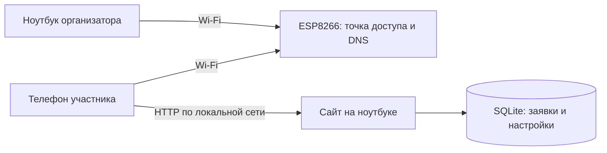

# Локальный портал Байкальской конференции

Учебный проект по дисциплине **«Технологии программирования»** для проведения конференции в месте без доступа к интернету. Участник подключается к сети NodeMCU ESP8266, открывает локальный сайт, знакомится с программой и регистрируется. Организатор управляет заявками и программой.

**Авторы:** Назаров Кирилл Андреевич, Кузнецова Татьяна Олеговна, Бурмакина Валерия Ивановна — группа **ЭВМб-23-1**, ИРНИТУ.

### Как это устроено



ESP8266 отвечает за сеть и DNS, ноутбук — за сайт и хранение данных. Внешний интернет не нужен. Проект проверен на NodeMCU и телефоне: регистрация, назначение места и админ-панель работают.

## Что уже реализовано

- Wi‑Fi сеть `Baikal_Conference` на ESP8266 (пароль `Baikal2026`).
- Перехват DNS имён в локальной сети для captive portal.
- Сайт конференции: информация, расписание, форма регистрации.
- Автоматическая выдача первого свободного места, проверка занятости мест и повторов email.
- Админ-панель: менять информацию и программу, управлять вместимостью, менять места, удалять заявки.
- SQLite база на ноутбуке и экспорт участников в CSV.
- Данные остаются после перезагрузки ESP и Mac; сессия администратора сбрасывается после перезапуска сервера.

## Требования

- NodeMCU ESP8266 и USB-кабель с передачей данных;
- Arduino IDE с установленным пакетом плат ESP8266;
- Mac с Python 3 (сайт использует только стандартную библиотеку Python);
- телефон или второй компьютер для демонстрации.

## 1. Прошить NodeMCU

1. В Arduino IDE выберите плату **NodeMCU 1.0 (ESP-12E Module)**. Если такого пункта нет, установите пакет плат ESP8266 в Boards Manager.
2. Убедитесь, что доступна библиотека `DNSServer` из пакета ESP8266 (обычно она уже входит).
3. Откройте `firmware/ConferenceAP/ConferenceAP.ino`, выберите порт NodeMCU и загрузите скетч.
4. Откройте Serial Monitor на скорости **115200**. После запуска должны появиться SSID и адреса.

Плата поднимает сеть `192.168.4.0/24`, сама доступна по `192.168.4.1`, а сайт должен находиться на Mac по `192.168.4.254`.

## 2. Запустить сайт на Mac

Откройте Terminal в папке скачанного проекта `baikal_conference` и выполните:

```bash
sudo -E python3 server.py
```

Сервер слушает HTTP-порт 80, нужный для captive portal. macOS попросит пароль пользователя Mac для `sudo`; при вводе символы не отображаются. Если появится запрос на входящие подключения Python, разрешите их. Оставьте окно Терминала открытым.

Для демонстрации заданы учётные данные администратора `admin` / `Baikal2026!`. Их можно изменить перед запуском:

```bash
sudo -E env ADMIN_USER=admin ADMIN_PASSWORD='другой-пароль' python3 server.py
```

Остановить сервер: `Control+C` в окне Терминала.

## 3. Подключить Mac и задать адрес

1. Подключитесь на Mac к Wi‑Fi `Baikal_Conference`, пароль `Baikal2026`.
2. В macOS откройте **Системные настройки → Wi‑Fi → Подробнее** рядом с этой сетью → **TCP/IP**.
3. Для **Настройка IPv4** выберите **Вручную** и укажите:
   - IP-адрес: `192.168.4.254`
   - Маска подсети: `255.255.255.0`
   - Маршрутизатор: `192.168.4.1`
4. В разделе DNS укажите `192.168.4.1`.
5. Сохраните. После показа проекта верните настройку IPv4 для этой сети в автоматический режим.

## 4. Проверить с телефона

1. Подключитесь к `Baikal_Conference` с паролем `Baikal2026`.
2. Если телефон сам не открыл страницу, введите в браузере `http://192.168.4.254`.
3. Отправьте тестовую регистрацию и убедитесь, что показывается назначенное место.
4. Для управления откройте `http://192.168.4.254/admin` на телефоне или Mac и войдите как администратор (`admin` / `Baikal2026!`).
5. Проверьте изменение настроек, места и CSV экспорт.

Автоматическое окно captive portal зависит от Android/iOS: система может показать уведомление «Войти в сеть», а может потребовать открыть браузер вручную. Поэтому для защиты используйте ручной адрес как гарантированный запасной вариант.

## Важные ограничения демонстрационной версии

- ESP8266 ограничен по числу клиентов; для показа лучше подключать несколько устройств, а не большую аудиторию конференции.
- У этой сети нет выхода в интернет. Телефоны могут спросить, оставаться ли в Wi‑Fi без интернета — выберите «подключиться всё равно».
- DNS отвечает адресом локального сайта на любые имена. Это предназначено для отдельной демонстрационной сети; не подключайте её к публичной/рабочей сети.
- Весь сайт доступен только по HTTP в локальной сети, поэтому не используйте настоящие пароли участников и не собирайте лишние личные данные.
- Удаление строки из списка админки удаляет заявку; SQLite файл `data/conference.db` хранит реальные данные проекта.
- Предустановленные пароли предназначены для учебного показа; перед другим применением смените их.

## Состав

- `server.py` — локальный сайт, обработчики форм и SQLite.
- `static/style.css` — оформление.
- `firmware/ConferenceAP/ConferenceAP.ino` — прошивка точки доступа/captive DNS.
- `data/` — создаваемое при запуске хранилище заявок.

Локальная база `data/conference.db` и служебные файлы Python исключены из Git. Инструкция проведения демонстрации находится в [`docs/DEMO.md`](docs/DEMO.md).
